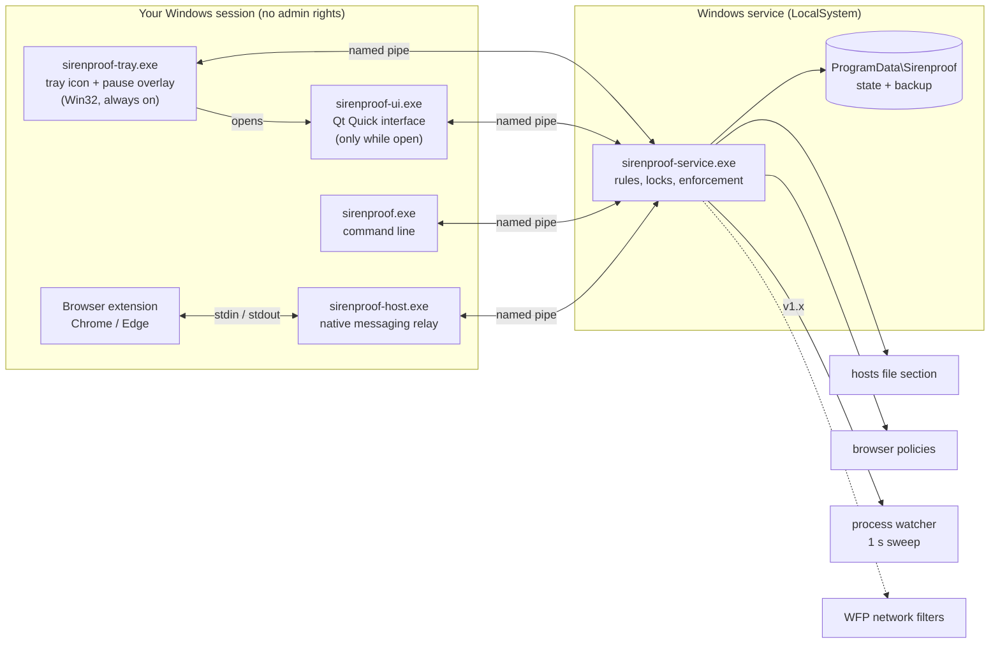

# Sirenproof plan

> Tie yourself to the mast.

**Status:** agreed 1 November 2026. M0 (foundation) and M1 (rule engine) are done. M2 (service and
enforcement) and M3 (browsers) are built; their virtual-machine acceptance tests ([TESTING.md](TESTING.md))
are still to run.
Evidence and sources:
[RESEARCH.md](RESEARCH.md).
References like [U5], [C2] or [T13] point to that document.

## 1. What Sirenproof is

Sirenproof is a free, open-source blocker for Windows 10 and 11. It blocks the websites (whole domains or
single pages) and desktop apps that pull you off track, using rules you set while you're calm. It then
holds you to those rules when the pull is strongest.

Everything runs on your PC. There's no account, no cloud and no telemetry. Nothing about your rules or your
browsing leaves the machine.

Windows comes first. Other operating systems may follow once Windows is solid.

### Who it's for

| Person | What they need from Sirenproof |
|---|---|
| **The reflexive checker** (students, knowledge workers, many people with ADHD) | Friction at the moment of the urge, and blocks that re-lock themselves. |
| **The gamer** | Games, launchers and Discord blocked on the same schedule as websites. |
| **The worst-moment user** (compulsive use, recovery) | A lock that genuinely holds until it ends. |
| **The mixed-use worker** (developers, researchers) | Page-level rules: YouTube tutorials and search yes; feed, Shorts and autoplay no. |

### Not in scope

- Controlling other people: no parental controls, no employee monitoring.
- Syncing across devices or phones (not in v1).
- Tracking productivity.

## 2. Principles

Each principle comes from a research finding. When a design question comes up, these settle it.

1. **Every unlock costs time or effort.** An instant off switch becomes the default [U1][U2][U4][U5].
2. **Tighten instantly, loosen slowly.** Adding blocks applies at once. Removing them waits out a delay.
   People drift looser over time, so the tool leans the other way [U28]. Plucky's delay-to-loosen is the
   best-liked idea in the market [C23].
3. **Two strengths, not one.** A gentle Nudge for reflexive opens, and a hard Lock for worst moments
   [U20][U30][U31][U11].
4. **Strong, but never system-breaking.** Never lock someone out of their whole browser, email, banking or
   the OS. A strong tool with no safety rails gets called malware [U10][C2].
5. **Precise.** Rules can target single pages and single apps, not just whole sites [U8][C13][C32].
6. **One rule system for sites and apps** [U3][U9][C8].
7. **Every exception expires on its own.** Breaks end on their own [U1][U5].
8. **Kind tone.** The block page shows *your* goal in *your* words, never a lecture. People already feel
   guilty, and distraction is often coping [U16][U22][U34].
9. **Local, private, transparent.** No network code in the service. A plain list of what gets installed.
   Uninstalls completely when no lock is active [C18][C19][C31].
10. **Never use a technique malware uses.** No kernel driver, no TLS interception, no Image File Execution
    Options hijack, no `SafeBoot` keys, no tricks with service permissions. This keeps antivirus and users
    on our side [T10][T28][T34][T38].
11. **Free, with nothing paywalled** [U13][C7][C12].

## 3. Features

### 3.1 Rules

A **rule** says *what* to block, *when*, and *how strongly*.

**What (targets)**

| Target | Example | How it's matched |
|---|---|---|
| Domain | `reddit.com` | The domain and all its subdomains. |
| Page | `youtube.com/shorts`, `youtube.com/feed`, `youtube.com/` | Host plus path prefix, with optional exact query parameters. |
| Allowed page | `youtube.com/watch?v=…`, `youtube.com/results` | An exception that wins over a broader block. |
| App | `C:\Program Files (x86)\Steam\steamapps\common\**`, `Discord.exe` | Path, folder, publisher signature, original filename or Store package name, so renaming or copying the exe doesn't help [T22]. |
| List | "Social", "Video", "Games", "News" | Ready-made groups of the above, editable. |

**When**

- **Session:** starts now and runs for N minutes.
- **Schedule:** weekly time windows, e.g. Mon–Fri 09:00–17:00.
- **Allowance** (v1.x): N minutes per day, then blocked.

**How strongly**

| Strength | What happens when you open a target | How you can loosen it |
|---|---|---|
| **Nudge** | A pause screen shows your goal and a short countdown. Then you choose: *Back to work*, or *Continue for 5 minutes*. After that, it re-blocks automatically. | Changes wait out a short delay (default 2 minutes). |
| **Block** | Blocked, with a calm page that shows your goal and when the block ends. | Changes wait out the rule's loosen delay (default 10 minutes). You can cancel a pending change. |
| **Lock** | Blocked, same page. | **Not at all** until the lock ends, except through the unlock method chosen when the lock started. |

### 3.2 How changes are applied

- **Changes that apply immediately:** adding a target, extending a schedule, raising a rule's strength, or
  lengthening its delay.
- **Changes that wait out the delay:** removing a target, adding an allowed page, shortening a schedule,
  lowering a rule's strength, or shortening its delay. Shortening the delay is itself a loosening change.
- **Pending changes stay visible** with a countdown. If you think better of it, cancel the change.

### 3.3 Locks and unlocking

You choose the unlock method when a lock starts, never afterwards:

- **None.** It holds until it ends.
- **Wait.** Request an early unlock, and it takes effect after a delay you chose (30 minutes to 3 hours).
  You can cancel the request.
- **Type it out.** Copy a long random string by hand. Paste is disabled.
- **Friend code.** A code is shown once when the lock starts. You give it to someone you trust. It works
  completely offline [C5].
- **Later (v2):** a hardware security key that you keep somewhere else [U9].

Before a lock starts, a **preview** lists exactly what it will block and allow. It also shows which running
apps will be closed and which browsers lack the extension. Nothing surprises you mid-lock.

### 3.4 Breaks and passes

- **Breaks:** "Take 5 minutes." They end by themselves, and the daily number is limited. During a lock,
  breaks are only available if the lock allowed them.
- **Emergency passes** (v1.x): a few per week. Raising the number counts as loosening.

### 3.5 Safety rails

These make the tool strong but never system-breaking:

- **A protected list that rules can never target:**
  - Windows system processes and Microsoft-signed files in the Windows folder.
  - Sirenproof itself.
  - Assistive technology: Narrator, Magnifier, NVDA, JAWS.
  - Security software.
  - Windows Update and Microsoft sign-in domains.
- **Apps get a warning before closing:** a 10-second notice, so you can save your work.
- **Browser fail-safe.** If the extension stops responding, Sirenproof explains why and how to fix it, and
  gives a grace period. During a lock, after the grace period, it closes that browser's windows with a clear
  explanation. It never blocks every browser just because a check failed [C2][C20].
- **Lock length is capped,** by default at 24 hours. Raising the cap counts as tightening.
- **Clean uninstall** when no lock is active. The hosts section, browser policies, network filters, the
  service and (optionally) your data are all removed.

### 3.6 Release scope

| v1.0 | v1.x | v2 and later |
|---|---|---|
| Rules: domains, pages, apps, lists | Daily allowances | "Hard mode" with Windows App Control |
| Nudge, Block, Lock | Allowlist work mode ("only these") [U6][C13] | Hardware-key unlock |
| Sessions and weekly schedules | Window-title rules (one Discord server, not all of Discord) | Other operating systems |
| Unlock: none, wait, type, friend code | Firefox | Translations |
| Breaks | Emergency passes | |
| Chrome and Edge extension | Per-app network blocking and DNS-over-TLS/QUIC blocking (WFP) | |
| Tray app, CLI, installer | Local stats ("blocked 23 times today") | |
| "Lock down this PC" setup (§3.8) | | |
| | Separate rules per Windows user | |

### 3.7 Interface

**Goal:** a distinctive, futuristic interface that is highly interactive, and costs nothing while you're
not looking at it.

**Look: a "deep-water HUD".** The visual idea comes from the name: a ship's instruments at night, holding
course past the Sirens.

- **Colour.**
  - Dark first: a near-black navy background, with a light theme that follows the Windows setting.
  - **One glowing accent** (sea-glass cyan) marks whatever is active.
  - **Amber** is reserved for pending loosenings and warnings.
  - Colour always means something, and is never the only signal.
- **The mast ring.** A circular gauge at the centre of the app shows the current session or lock.
  - It fills as time passes, and locked segments look *bound* (a rope-like stripe).
  - The same ring appears on the block page and the pause overlay, so it becomes the brand.
- **Feedback.** When something is blocked, a single sonar-style ripple. It's subtle, once, and never loops.
- **Type.** A geometric sans for text. Tabular digits for timers, so countdowns don't jitter. A custom set
  of thin-line SVG icons.
- **Motion.** 150–250 ms transitions, and spring physics when dragging. Nothing animates forever except a
  very slow breathing glow on an active lock.

**Interaction**

- **Command palette (Ctrl+K).** Type `lock youtube 2h` or `break 5m`. It uses the same grammar as the CLI,
  so keyboard users never need the mouse.
- **Paint the schedule.** Drag across a week grid of hours to paint when a rule applies.
- **Live rule tester.** Type a URL, or pick a running app, and see immediately which rule matches and why.
- **Hold to commit.** Starting a Lock means pressing and holding for 2 seconds while the mast ring fills. It
  makes a lock a deliberate act and prevents accidents.
- **Animated lock preview.** Before a lock starts, it shows what's about to happen: sites, apps that will
  close, browsers missing the extension.
- **Running now.** A live list of open apps. Drag one onto a list to block it.
- **Pending changes as countdown cards.** One click cancels a loosening.
- **Built-in unlock challenges.**
  - A type-it-out field, with paste disabled.
  - Friend-code entry.
  - A wait countdown.

**Built light: four surfaces, each with a budget**

| Surface | Built with | Budget |
|---|---|---|
| **Tray** (always running) | Plain Win32, no Qt | ≤ 3 MB RAM. 0% CPU and no timers when nothing is active. |
| **Main window** | Qt Quick (GPU scene graph) | Separate process, started only when opened, exits on close, so it costs **nothing** while closed. Cold start ≤ 400 ms. 60 fps during animation. Draws only when something changes. |
| **Pause overlay** (Nudge for apps) | Direct2D layered window drawn by the tray | On screen ≤ 100 ms after the app is caught. |
| **Block page** (browser) | Static HTML/CSS in the extension, no framework | ≤ 50 KB. No downloaded fonts. Animates only `transform` and `opacity`, so the GPU composites it. |

How the Qt Quick window stays fast:

- QML is compiled ahead of time (`qmlsc` / `qmlcachegen`), and shaders are precompiled at build time
  (`qt6-shadertools`).
- Animations run on the render thread (Animators).
- Pages load lazily (`Loader`). No full-window layers or masks.
- It falls back to Qt's software renderer on old GPUs and in virtual machines.

**Accessibility is not optional** (principle 4):

- Full keyboard navigation and screen-reader names on every control.
- Text contrast of at least 4.5:1.
- Scales with Windows' text size.
- Honours Windows' "Animation effects" setting: with animations off, the ripple and glow switch off and
  transitions become instant.

**Design before code.** M4 starts with a style guide and a clickable prototype of the main screens. The
look is agreed before any screen is built in QML.

### 3.8 Lock down this PC

The service already runs as SYSTEM, above any administrator. But no legitimate program can stop an
administrator who is determined to remove it: Safe Mode, taking ownership of files, reinstalling
Windows. Software that tries uses rootkit techniques and gets removed as malware (principle 10).

The strongest protection is therefore for the person not to be an administrator day to day. A guided
setup, offered after the first lock and always available later, does this:

1. Checks whether the everyday Windows account is an administrator.
2. Helps create a separate administrator account.
3. Has its password handed to a trusted person, or written down and sealed away, like a friend code.
4. Switches the everyday account to a standard one.

With a standard account, stopping or killing the service, editing the hosts file, uninstalling,
changing the clock and getting into Safe Mode all need the administrator password. The setup explains
each step and can be undone with that password. Sirenproof never changes accounts silently.

## 4. Architecture



**The service is the only authority.** It holds the rules and the lock state, decides what's blocked, and
applies it. Everything else is a view or a messenger. Killing the tray app changes nothing.

### 4.1 Components

| Component | Language | Job |
|---|---|---|
| `core` (static library) | C++20, no Windows headers | Rule model and JSON, matching (domains, pages, apps), schedules, the Nudge/Block/Lock state machine, change rules, trusted clock logic, the pipe protocol. Pure logic, fully unit-tested. |
| `platform` (static library) | C++23 + Win32 | Hosts-file section, process watcher (1-second sweep), process identity (path, signer, original filename, package), closing and suspending processes, browser policies in the registry, secure pipe server and client, service plumbing, monotonic clock. |
| `sirenproof-service.exe` | C++ | Runs as LocalSystem and starts automatically, with restart-on-failure. Runs the enforcers and serves the pipe. |
| `sirenproof.exe` | C++ | Command line: `status`, `rules`, `block`, `lock`, `unlock`, `break`, `check <url\|exe>`. Lets us build and test everything before there's a GUI. |
| `sirenproof-tray.exe` | C++ + Win32 / Direct2D | Always-on and tiny. Tray icon and menu, notifications, the Nudge pause overlay for apps. Starts the main window when asked. |
| `sirenproof-ui.exe` | C++ + Qt Quick (QML) | The full interface (§3.7): mast ring, rule editor, lists, schedule painter, rule tester, lock setup with preview, unlock challenges, pending changes. Runs only while open. |
| `sirenproof-host.exe` | C++ | Tiny relay between the extension (stdin/stdout) and the pipe. Validates every message. |
| `extension/` | JavaScript (Manifest V3), no build step | Asks the service about every page load (`webNavigation.onBeforeNavigate`) and in-page navigation (`onHistoryStateUpdated`), so all matching stays in one place, the C++ core. Shows the block and pause page. Sends a heartbeat. `declarativeNetRequest` rules are a later optimisation if pages flash before the block appears. |
| `installer/` | Inno Setup | Installs the service, registers the native messaging host and sets up the data folder with locked-down permissions. Its uninstall refuses while a lock is active. |

### 4.2 Enforcement layers

| Layer | Catches | Misses | Arrives |
|---|---|---|---|
| **Hosts file** (one section, between `# BEGIN Sirenproof` and `# END Sirenproof` markers) | Whole domains, in every app | Single pages. Resolvers that bypass the OS (handled by the policies row) | M2 |
| **Browser extension** | Single pages, YouTube-style in-page navigation, the Nudge pause page | Browsers without it. During a lock, the service's browser guard closes them after a warning and a 60 s grace period. A heartbeat only counts if the service traces it, through the process tree, to a real browser that started the relay | M3 |
| **Browser policies** (Chrome/Edge registry) | Turn off DNS-over-HTTPS; turn off Incognito/InPrivate during a lock; stop the extension being removed (needs a store listing) [T17]–[T19] | Unmanaged-PC quirks, to verify in M3 [T21] | M3 |
| **Process watcher** | Apps and games, within about a second of launch. A sweep every second, and only while a program rule is active, so it costs nothing otherwise. (ETW was the first idea, but its events arrive 1–3 s late [T24] and it needs admin, so it's kept as a later optimisation.) | Blocking before launch (would need a kernel driver; we won't) | M2 |
| **WFP filters** | Per-app network access; DNS-over-TLS, QUIC, known DNS-over-HTTPS endpoints | — | v1.x |

### 4.3 Data

- **State:** `%ProgramData%\Sirenproof\state.json` plus a last-known-good backup.
  - The folder's permissions allow only SYSTEM and Administrators. Users go through the service.
  - Writes are atomic: write to a temp file, then replace.
- **Integrity:** the state file carries an HMAC with a key protected by DPAPI. If someone edits the file by
  hand, the service keeps enforcing the last good state and logs it as a tamper event.
- **Logs:** rotating log files in the same folder. They never leave the PC.

### 4.4 Pipe protocol

- **Pipe:** `\\.\pipe\Sirenproof.v1`.
- **Framing:** a message-mode pipe, so each request and each reply is exactly one pipe message of UTF-8
  JSON. Messages are capped at 64 KiB.
- **Requests:** `{"v":1,"id":7,"op":"lock.start","args":{…}}`
- **Responses:** `{"id":7,"ok":false,"error":{"code":"loosen_delayed","until":"…"}}`
- **Each kind of client gets an allow-list of operations.**
  - The relay (identified by its verified path and signature) may only use `ext.*` operations.
  - The tray and CLI may use the user operations.
  - No operation ever takes a command line, a file to execute or an IP address.

## 5. Security

"Completely secured" means two different things here. Both are designed for explicitly.

### 5.1 Against your own impulses (tamper resistance)

**Goal:** defeat *impulsive* bypasses, the kind that take seconds or minutes. Without a kernel driver,
someone with admin rights and hours to spare can always win [T33][T35]. We say so openly. The "Lock
down this PC" setup (§3.8) moves the everyday account to a standard one, which closes almost every
bypass below.

| Bypass attempt | Response |
|---|---|
| Edit the hosts file back | A file watcher restores the section within a second and flushes DNS. |
| Incognito / InPrivate | Turned off by policy during a lock. |
| Another browser | Browsers without a heartbeat get a warning, then a grace period, then their windows close (locks only). Unsupported browsers can be blocked as apps. |
| Disable or remove the extension | Force-installed by policy (store builds). Otherwise, same as another browser. |
| Kill the tray app | Nothing changes. The tray is only a view. |
| Stop or kill the service | During a lock, the service refuses stop requests. If killed, Windows restarts it, and it fails closed: it reapplies everything on start. |
| Uninstall | The uninstaller asks the service, and refuses during a lock. |
| Change the clock | Lock time is counted with a clock Windows' time setting can't change (`QueryUnbiasedInterruptTime`), and the remaining time is stored, not an end timestamp [T36]. Schedules use a "trusted time" that ignores manual clock jumps while a rule is active. |
| Change the time zone | Moves local time, which weekly schedules use, without moving UTC. In M2 the local offset goes through the same check as clock jumps, so a zone change that would loosen a rule in force is ignored until it's safe. |
| Reboot | The service starts automatically, loads the remaining time, and fails closed. |
| Rename or copy a game's exe | Matched by signer, original filename, folder or hash. |
| Edit `state.json` | Folder permissions block normal users. An HMAC detects edits, and the last good state stays in force. |
| Safe Mode | Not defended in v1. Doing so takes malware-like registry keys [T38]. Documented. |
| Use the phone | Out of scope. Documented. |

### 5.2 Protecting your PC from Sirenproof

A service running as SYSTEM with a pipe is a classic privilege-escalation target. Rules:

- **Pipe access.**
  - The access list allows SYSTEM and Administrators full access, and the interactive user read/write only.
  - Remote clients are rejected. The first-instance flag prevents pipe squatting.
  - Clients confirm the server process really is the service before trusting it.
- **Strict input handling.**
  - Size limits on every message, and unknown fields are rejected.
  - Every string is validated: domains are normalised and checked; paths are canonicalised.
- **The service can only *block*.**
  - It never runs a program, never writes an IP address other than `0.0.0.0` / `::` into hosts, never
    redirects a domain somewhere else, and never touches protected processes.
  - Even a fully compromised client can only make your PC *more* blocked.
- **Files.** The data folder gets explicit permissions (SYSTEM and Administrators only).
  - Anyone can create folders under ProgramData. So an existing data folder is refused if it's a
    junction or link, or if an ordinary user owns it.
  - Every write goes through a temporary file in that folder, then an atomic swap.
- **Where it runs from.** `install` refuses unless the exe is in a folder only administrators can
  change, such as Program Files. A SYSTEM service anyone could replace would hand over the PC.
- **No DLL planting.** The service and CLI are linked statically, so a SYSTEM process never loads the
  C++ runtime from some folder on the `PATH`.
- **The pipe.**
  - Ordinary users may read and write messages, but never create pipe instances.
  - Clients connect with identification-only rights, so the service can't act as them.
  - The CLI only believes a service that runs from its own folder.
- **No network code** in the service or the relay. The extension makes no remote calls and loads no remote
  code. Its permissions are listed and explained in the README.
- **Build hardening.**
  - `-fstack-protector-strong`, `_FORTIFY_SOURCE`, ASLR and DEP (`--dynamicbase`, `--nxcompat`,
    `--high-entropy-va`).
  - Warnings as errors in CI.
  - `clang-tidy`.
  - Later: a fuzzer on the protocol parser, using MSYS2's clang environment.
- **Releases.** Built by CI from tagged commits. SHA-256 checksums published. Signed binaries (see risks).
  `SECURITY.md` explains how to report a vulnerability.

## 6. Tech stack

| Area | Choice | Why |
|---|---|---|
| Language | C++23 | Your choice. Every Win32 API we need is plain C. C++23 adds `std::expected`, for error handling without exceptions. Fully supported by GCC 16. |
| Toolchain | MSYS2 UCRT64: g++ 16.2, CMake 4.4, Ninja | Already installed. Verified against every API in the plan ([RESEARCH.md §3.5](RESEARCH.md#35-toolchain-check-msys2-ucrt64-g-1620)). |
| JSON | nlohmann-json 3.12 | Header-only and widely used. In MSYS2. |
| Tests | Catch2 3 | In MSYS2. Integrates with CTest. |
| Main window | **Qt Quick 6.11 (QML)** | GPU-accelerated scene graph, custom-drawn controls, shaders and smooth animation for the futuristic look. Screen-reader support. LGPL when linked dynamically. In MSYS2 (`qt6-declarative`, `qt6-shadertools`, `qt6-svg`). Chosen over Qt Widgets (standard native look), Dear ImGui (no screen-reader support) and WebView2 (heavy, and a bigger attack surface). |
| Tray and overlay | **Win32 + Direct2D / DirectWrite** | Keeps the always-running part tiny with no Qt loaded. Headers and libraries verified in MSYS2. |
| Extension | JavaScript, Manifest V3 | Required by Chrome and Edge. Kept dependency-free. |
| Installer | Inno Setup 6 | Free. Its uninstall code can refuse during a lock. MSIX can't [T43][T44]. |
| CI | GitHub Actions + `msys2/setup-msys2` | Same toolchain as on your PC. |
| License | **GPL-3.0-or-later** | Keeps forks open, which matters for a tool people must trust. Compatible with Qt under the LGPL. |

## 7. Repository layout

```
Sirenproof/
├─ CMakeLists.txt, CMakePresets.json   MSYS2 UCRT64 debug / release presets
├─ cmake/                              Warnings, hardening flags, helpers
├─ core/            include/ src/      Pure logic library (no Windows headers)
├─ platform/        include/ src/      Win32 enforcers, pipe, service plumbing
├─ service/                            sirenproof-service.exe
├─ cli/                                sirenproof.exe
├─ tray/                               sirenproof-tray.exe (Win32 + Direct2D)
├─ ui/                                 sirenproof-ui.exe (Qt Quick / QML)
├─ host/                               sirenproof-host.exe (native messaging relay)
├─ extension/                          Chrome / Edge extension (MV3)
├─ installer/                          Inno Setup script
├─ tests/                              Catch2 unit tests (core), platform tests
├─ tools/                              Dev scripts, e.g. dev-reset.ps1 (undo all system changes)
├─ docs/                               RESEARCH.md, PLAN.md, ARCHITECTURE.md, SECURITY.md
├─ README.md, LICENSE, CONTRIBUTING.md, SECURITY.md, .clang-format, .editorconfig
```

## 8. Milestones

Each milestone ends with something that runs, and a clear "done when".

| # | Milestone | Contents | Done when |
|---|---|---|---|
| **M0** | Foundation | Repo skeleton, CMake presets, hardening flags, `core` with first tests, CI, LICENSE, README, CONTRIBUTING, SECURITY.md. | `ctest` passes locally and in GitHub Actions. |
| **M1** | Core engine (no system changes) | Rule model and JSON; domain, page and app matching; schedules; Nudge/Block/Lock state machine; tighten-now / loosen-later rules; trusted clock; unlock methods. CLI `check` and `plan` commands print what *would* be blocked. | Unit tests cover loosen delays, lock expiry, and simulated clock jumps and reboots. |
| **M2** | Service and enforcement | Service install and run; secure pipe; state with integrity check; hosts section with watcher; process watcher, app identity and close-with-warning; clean uninstall; CLI talks to the service; `tools/dev-reset.ps1`. *Built and integration-tested; VM acceptance test pending.* | In a VM, a 25-minute lock on `youtube.com` and Steam survives a hosts edit, killing the service, a clock change and a reboot. Uninstalling when unlocked leaves nothing behind. |
| **M3** | Browsers | Extension and relay; page rules; YouTube in-page navigation; block and pause pages; heartbeat with grace period; DNS-over-HTTPS and private windows turned off by policy during a lock (Chrome, Edge, Brave), with the previous values restored afterwards. *Built and integration-tested; VM acceptance test pending.* | Shorts and the feed are blocked while `/watch` works. Incognito is unavailable during a lock. A disabled extension leads to warning, grace period, then closed windows with an explanation. |
| **M4** | Interface | Style guide and clickable prototype approved first (done, see decision 6). *In progress: the main window's Now, Rules (with the schedule painter) and Start a lock screens, the command palette, the "Lock down this PC" setup, the tray and the pause for programs are built, and the §3.7 budgets are measured and met (docs/TESTING.md). Still to do: the usability test.* Win32 tray and Direct2D pause overlay. Qt Quick main window: mast ring, command palette, schedule painter, rule tester, ready-made lists, lock setup with hold-to-commit and preview, unlock challenges, pending changes, breaks. "Lock down this PC" setup (§3.8). | Two or three non-technical people set up a scheduled block without the CLI or any help. The §3.7 budgets are measured and met. |
| **M5** | v1.0 release | Installer (refuses uninstall during a lock), signing, Chrome Web Store and Edge Add-ons listings, Defender testing, threat-model review, docs, checksums. | Signed installer on GitHub Releases. Install → use → uninstall passes on a fresh VM. |

M0 and M1 are pure C++ logic and make no system changes. They're the safest place to start, and they
exercise every hard decision (rules, locks, clocks) before anything touches Windows.

## 9. Developing a blocker safely on your own PC

- **Dry run.** Debug builds default to `--dry-run`: they log what they *would* block and change nothing.
- **Debug limits.** Debug builds cap locks at 2 minutes and have a dev-only escape hatch. Release builds
  have neither.
- **Test real enforcement in a virtual machine.** Windows 11 Home has no Hyper-V or Windows Sandbox, so use
  VirtualBox with a Windows VM.
- **An undo script.** `tools/dev-reset.ps1` removes everything Sirenproof can change: the hosts section,
  policies, the service and network filters.

## 10. Risks

| Risk | Impact | Mitigation |
|---|---|---|
| Defender flags hosts edits [T3] | Blocks reset; users alarmed | Test in M2. The extension is the main browser layer and hosts the backup. Small, clearly marked section. |
| Chrome ignores some registry policies on unmanaged PCs [T21] | Weaker browser hardening | Verify each policy in M3. Fall back to heartbeat plus app rules. |
| Force-install needs a store listing [T17] | Extension removable before v1.0 | Heartbeat enforcement until listed. Chrome Web Store costs a one-time $5 developer fee; Edge Add-ons is free. |
| Code signing cost; SmartScreen warnings [T40][T41] | "Unknown publisher" warnings scare users | Look into free signing programmes for open-source projects (e.g. SignPath Foundation; eligibility to check). Azure Trusted Signing is only open to individuals in the US and Canada. |
| A fail-closed bug causes a permanent block [T42] | User locked out; trust destroyed | Safety rails, protected list, lock cap, extensive tests, VM-only testing, `dev-reset.ps1`. |
| 1–3 s delay before an app closes [T24] | A game flashes open | Accept it. Show a calm notice. A Nudge never closes or freezes a program (decision 7). |
| Qt Quick adds ~40 MB to the install, and some GPU drivers misbehave | Bigger download; glitches on old PCs | The window runs only while open, so there's no idle memory cost. Software-renderer fallback. Deploy only the Qt modules used. |
| A flashy UI hurts focus or performance | The tool becomes a distraction itself | §3.7 budgets, motion only with purpose, Windows' animation setting honoured. |
| Scope creep | Never ships | Hold to the v1.0 column in §3.6. Everything else waits. |

## 11. Decisions

Agreed on 1 November 2026:

1. **Interface:** unique, futuristic, highly interactive and light (§3.7). Qt Quick main window that runs
   only while open, and a Win32 tray. This replaces the earlier Qt Widgets proposal.
2. **License:** GPL-3.0-or-later.
3. **Defaults:** maximum lock length 24 h, Block loosen delay 10 min, Nudge pause 15 s.
4. **Extension stores:** Chrome Web Store and Edge Add-ons before v1.0.
5. **Firefox:** v1.x.
6. **Interface design** (2 November 2026): the clickable prototype of the "deep-water HUD" was
   approved. It covers the main window's Now, Rules (with the schedule painter and rule tester) and
   Start a lock (hold to commit) screens, the "Lock down this PC" setup, the command palette and the
   tray flyout. M4 builds those in Qt Quick.
7. **Nudges for programs** (3 November 2026): a program caught by a Nudge rule is neither closed nor
   frozen, since freezing can break games, calls and anything online. The service marks it paused, and
   the tray covers the screen in use with the pause: the goal, a countdown, then "Continue for a few
   minutes" or "Close it". Only the program waiting at the pause can be closed that way. The tray
   learns about it, and every other change, by waiting on the service (`events.wait`) rather than
   asking on a timer.
